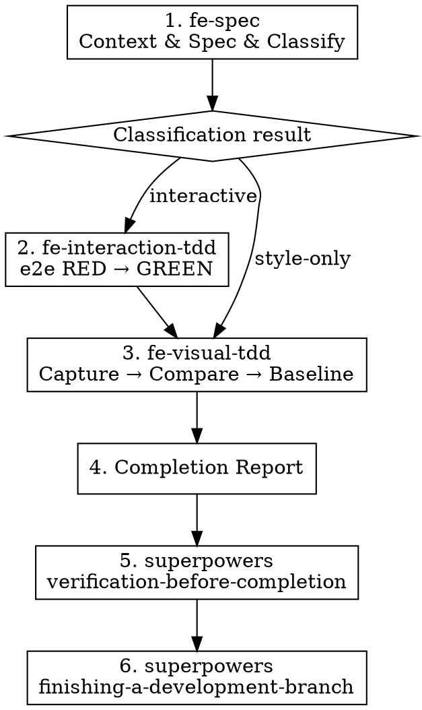

# Frontend Harness — Orchestrator

Orchestrates the full flow for frontend UI work.
Each step is an independent skill; this orchestrator invokes them in order.



## Modes

| Mode | When | Flow |
|------|------|------|
| **classic** (default) | Checkpoint mode not requested | [Execution Flow](#execution-flow) below |
| **checkpoint** | The user requests checkpoint mode | [Checkpoint Mode](#checkpoint-mode) |

## Execution Flow

### Step 1. Invoke fe-spec

Invoke `fe-spec` via the Skill tool. Receive the spec and classification result.

- Figma URL present → Figma mode
- Code path only → Code mode
- Follow all STOP gates defined by fe-spec

### Step 2. Branch by Classification

| Classification | Path |
|----------------|------|
| **style-only** | Invoke fe-visual-tdd only (skip to Step 3) |
| **interactive** | Invoke fe-interaction-tdd, then fe-visual-tdd |

### Step 2-a. Invoke fe-interaction-tdd (interactive only)

Invoke `fe-interaction-tdd` via the Skill tool. Pass the interaction spec from fe-spec.

- Follow all STOP gates defined by fe-interaction-tdd
- Wait until GREEN is confirmed

### Step 3. Invoke fe-visual-tdd

Invoke `fe-visual-tdd` via the Skill tool.

- Figma nodeId present → Figma mode
- No nodeId → Baseline mode
- Follow all STOP gates defined by fe-visual-tdd

### Step 4. Completion Report

Refer to [references/completion-guide.md](references/completion-guide.md) to report artifacts and regression setup.

### Step 5. superpowers verification-before-completion

Invoke `superpowers:verification-before-completion` via the Skill tool.

- Verify full test suite passes
- Verify lint/typecheck passes
- Verify build succeeds

### Step 6. superpowers finishing-a-development-branch

Invoke `superpowers:finishing-a-development-branch` via the Skill tool.

- Present commit/PR/merge options

## Checkpoint Mode

The unit of work is a checkpoint (CP) small enough to review in a few minutes.
Each CP passes automatic gates and a two-reviewer gate, then one user approval commits it.

```
fe-spec (checkpoint mode) ─ STOP: spec + plan
  └─ for CP-1 … CP-n, in order:
       G1  tests → RED       (automatic, RED evidence block)
       G2  implement → GREEN (automatic, GREEN evidence block)
       G3  fe-visual-tdd on this CP's VT items (only if it has any; verdict blocks)
       G4  reviewers A + B   (fix → back to G2; max 2 rounds)
       G5  STOP: checkpoint report → approve → commit
  → completion report → verification → finishing
```

User STOPs: plan approval once + G5 once per CP. Nothing else asks the user unless an
evidence condition fails.

### Step C1. Plan

Invoke `fe-spec` in checkpoint mode. Its one STOP approves the spec and the checkpoint plan.

### Step C2. Run each checkpoint

**G1–G2 (logic / interactive CPs).** Invoke `fe-interaction-tdd` in checkpoint mode with the
CP id, classification, test items, and state fixtures. It returns a RED evidence block, then
a GREEN evidence block, without stopping in between.

**G2 (style-only CPs).** Implement only. G3 is this CP's pass/fail signal.

**G3 — Visual (CPs with VT items).** Invoke `fe-visual-tdd` in checkpoint mode with the CP's
VT items, fileKey, viewport, and state fixtures. Every VT item must return PASS with its
verdict block. CPs without VT items skip G3.

**Evidence condition fails** (RED cannot be shown, stall counter hits 3, an earlier CP's test
breaks) → stop the loop and hand it to the user with the evidence block.

**G4 — Review gate (every CP).** Two independent reviewers read the CP diff, prompts in
[references/review-gate.md](references/review-gate.md):

- **Reviewer A — spec fidelity:** missing states, implementation that only satisfies the tests
  (hardcoding, test-only branches), missing accessible names.
- **Reviewer B — maintainability:** missed reuse, needless abstraction, unstable selectors,
  comments that restate code.

Close every finding as `fixed` or `rejected — <reason citing spec, plan, or a repo file>`.
Any fix → back to G2 for new GREEN evidence (and G3 if the CP has VT items), then a new review round.
**At most 2 review rounds per CP.** Open findings after round 2 → STOP and hand to the user.

**G5 — STOP: checkpoint report.** Present it in this shape and wait:

```markdown
## CP-3 — Wire sections into page, expand
- diff: 3 files, +118 −12
- RED → GREEN: IT-3, IT-4 (evidence blocks below), earlier CP tests 4/4 passing
- visual: VT-2 PASS (verdict block below)
- review: A 2 (fixed 1, rejected 1 — <reason>), B 1 (fixed 1), rounds 2
- state fixtures: profile.diagnosisDone, report.toefl.basic
- next: CP-4 Empty and error states
<RED evidence block>
<GREEN evidence block>
<VT verdict blocks>
```

| User answer | Action |
|-------------|--------|
| Approve | Commit this CP (one commit per CP), start the next CP |
| Request changes | Take the reason, redo from G2, present G5 again |
| Revise plan | Re-plan the remaining CPs with fe-spec, then continue |

### Step C3. Finish

After the last CP: Step 4 → Step 5 → Step 6 of the classic flow. The completion report adds one line per CP (title, commit, items).

## ABSOLUTE RULES

1. **Never skip skill order.** fe-spec → (fe-interaction-tdd →) fe-visual-tdd → verification → finishing.
2. **Classic mode: respect each sub-skill's STOP gates.** The orchestrator must not override or bypass a sub-skill's STOP.
3. **Checkpoint mode: sub-skill phase STOPs become evidence blocks.** User STOPs are the plan
   approval and G5 for every CP. A CP is never committed without its G5 approval.
4. **Checkpoint mode: one CP at a time.** CP-n+1 starts only after CP-n is committed.
5. **Checkpoint mode: every review finding reaches G5** as fixed or rejected with a cited reason.
6. **Follow the exact path for the classification result.** Never skip fe-interaction-tdd when classification is interactive.

### Rationalization Table — If you think this, STOP

| If you think… | What you must do |
|----------------|-----------------|
| "This is a simple change, skip spec and jump to implementation" | Start with fe-spec. Always. |
| "Tests already exist, skip fe-interaction-tdd" | If classified as interactive, it must run. |
| "Visual verification can wait until later" | fe-visual-tdd must complete before the completion report. |
| "Verification isn't really necessary" | superpowers verification checks overall project health. Always run it. |
| "GREEN and build pass, commit and keep going" | Checkpoint mode: commit only after G5 approval. |
| "Two CPs are small, approve them together" | One G5 per CP. |
| "This finding is nitpicking, skip it" | Fix it or reject it with a cited reason. It appears in G5 either way. |
| "One more review round will clear it" | Round 2 is the last. Hand open findings to the user. |

## Checklist

Classic mode:

- [ ] Invoke fe-spec → obtain spec + classification
- [ ] Select correct path based on classification
- [ ] (interactive) Invoke fe-interaction-tdd → obtain GREEN
- [ ] Invoke fe-visual-tdd → obtain baseline
- [ ] Output completion report
- [ ] Invoke superpowers verification-before-completion
- [ ] Invoke superpowers finishing-a-development-branch

Checkpoint mode:

- [ ] Invoke fe-spec in checkpoint mode → spec + plan approved
- [ ] Per CP: RED evidence → GREEN evidence → visual verdicts (if VT items) → review gate (≤2 rounds) → G5 report — **STOP, wait for approval** → commit
- [ ] Completion report (with per-CP lines) → verification → finishing
